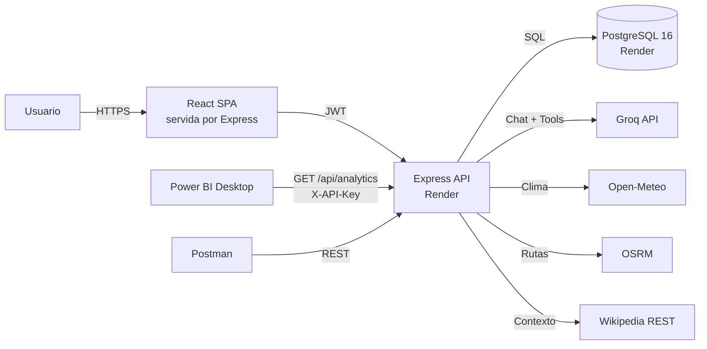

# RutaIA — Proyecto final de Programación Comercial

Aplicación web con servicios de Inteligencia Artificial: chatbot con RAG, dos agentes
multi-paso, autenticación por roles, control de consumo de tokens, API REST documentada,
reporte web y reporte de Power BI.

**Enfoque:** turismo exclusivamente en **Guatemala** (22 departamentos, 12 destinos en el catálogo demo,
48 actividades y precios en quetzales GTQ). La interfaz incluye modo claro/oscuro y menú
lateral colapsable.

**Stack:** React + Vite · Express · PostgreSQL 16 · Groq (tool calling) · Docker · GitHub Actions.

## Enlaces de la entrega (producción)

| Recurso | URL |
|---|---|
| **Aplicación web** | https://rutaia-api-q3y2.onrender.com |
| **Swagger / API docs** | https://rutaia-api-q3y2.onrender.com/api/docs |
| **API (JSON OpenAPI)** | https://rutaia-api-q3y2.onrender.com/api/docs.json |
| **Power BI** | `GET https://rutaia-api-q3y2.onrender.com/api/bi/usage` con cabecera `X-API-Key: rutaia_ce9e9b1489b894c17550d818ee956a4dcdbc0529d2c59cc7` |
| **Health check** | https://rutaia-api-q3y2.onrender.com/api/health |

- Usuarios demo: `admin@rutaia.local` / `Admin123!` y `demo@rutaia.local` / `Demo123!`.
- El plan gratuito de Render suspende el servicio tras 15 minutos sin tráfico; la
  primera petición puede tardar ~50 s en despertarlo.

---

## Requisitos del proyecto

- Chatbot con **RAG** sobre la base de datos y **memoria conversacional**.
- **Dos servicios adicionales de IA** que resuelvan solicitudes en varios pasos (agentes).
- Login con roles **administrador / usuario** y CRUD administrativo.
- Registro automático de conversaciones, historial y **consumo de tokens** con bloqueo por límite.
- **API REST** con autenticación, permisos, Swagger y demostración en Postman.
- **Power BI** conectado a la API, con filtros por fecha y servicio.
- Pruebas automatizadas, despliegue en la nube y **CI/CD** que despliega solo si las pruebas pasan.

---

## Arquitectura



La página web de reportes y Power BI consumen **el mismo endpoint** de analítica para que
los resultados coincidan.

---

## Estructura del repositorio

```text
PROYECTOFINAL/
├── client/                  # React + Vite (SPA)
├── server/                  # Express API (Node.js)
│   ├── src/
│   │   ├── config/          # Entorno, PostgreSQL, constantes y OpenAPI
│   │   ├── middleware/      # Request ID, errores, JWT, roles y validación
│   │   ├── errors/          # AppError
│   │   ├── routes/          # Router principal y health check
│   │   ├── modules/         # auth, users, catalog, services, usage, chat, agents
│   │   ├── rag/             # Documentos, sincronización y recuperación tsvector
│   │   ├── agents/          # Bucle multi-paso y tool calling
│   │   ├── tools/           # Catálogo, Open-Meteo, OSRM y Wikipedia
│   │   ├── utils/           # JWT, bcrypt y paginación
│   │   ├── ai/              # Cliente Groq y normalización de respuestas
│   │   ├── app.js           # Configuración de Express
│   │   └── server.js        # Arranque y cierre ordenado
│   ├── scripts/             # seed, ingest
│   ├── tests/               # Pruebas con Vitest + Supertest
│   └── vitest.config.js
├── db/
│   ├── schema.sql           # Creación de tablas
│   └── seed.sql             # Datos de demostración
├── docs/                    # Swagger exportado, Postman, capturas
├── powerbi/                 # Reporte .pbix
├── .github/workflows/       # CI/CD
├── docker-compose.yml       # PostgreSQL 16 local
├── .env.example             # Variables de Docker Compose
└── README.md
```

---

## Modelo de datos

PostgreSQL 16 con UTF-8 y almacenamiento en UTC. El detalle está en
[`db/README.md`](db/README.md) y el DDL completo en
[`db/schema.postgres.sql`](db/schema.postgres.sql).

| Tabla | Propósito |
|---|---|
| `users` | Usuarios, roles y cuota mensual de tokens |
| `destinations` / `activities` | Catálogo turístico administrable |
| `documents` | Fragmentos indexados con `tsvector` para el RAG |
| `ai_services` | Configuración de los tres servicios de IA |
| `conversations` / `messages` | Historial del chatbot y de los agentes |
| `usage_logs` | Hechos de consumo para la analítica y Power BI |
| `agent_runs` | Traza de pasos de cada ejecución de agente |
| `api_clients` | API keys con hash para consumidores externos |
| `external_cache` | Caché de Open-Meteo, OSRM y Wikipedia |

El panel web (`GET /api/analytics/usage`) y Power BI
(`GET /api/bi/usage` con `X-API-Key`) calculan el reporte con la misma
función `getUsageAnalytics`, por lo que las cifras coinciden. Los detalles de conexión
están en [`powerbi/README.md`](powerbi/README.md).

Datos iniciales: 3 usuarios, 12 destinos, 48 actividades, 3 servicios de IA,
3 conversaciones, 6 mensajes, 22 registros de consumo y 60 documentos para el RAG.

## API

La API está disponible en `http://localhost:4000` y su documentación interactiva en
`http://localhost:4000/api/docs`. El documento OpenAPI se puede consumir en
`http://localhost:4000/api/docs.json`.

| Método | Ruta | Autenticación | Descripción |
|---|---|---|---|
| GET | `/` | Pública | Información general del servicio |
| GET | `/api` | Pública | Información de la API |
| GET | `/api/health` | Pública | Estado de la API y de PostgreSQL |
| GET | `/api/docs` | Pública | Swagger UI |
| GET | `/api/docs.json` | Pública | Especificación OpenAPI 3.0.3 |
| POST | `/api/auth/login` | Pública | Inicio de sesión y entrega del JWT |
| GET | `/api/auth/me` | JWT | Usuario autenticado y su cuota |
| GET | `/api/users` | JWT admin | Lista paginada de usuarios con filtros |
| POST | `/api/users` | JWT admin | Crea un usuario (no hay registro público) |
| GET | `/api/users/:id` | JWT admin | Detalle de usuario y cuota |
| PATCH | `/api/users/:id` | JWT admin | Actualiza datos, rol, cuota o estado |
| DELETE | `/api/users/:id` | JWT admin | Desactiva un usuario (borrado lógico) |
| GET | `/api/destinations` | Pública | Lista destinos con filtros y paginación |
| GET | `/api/destinations/:id` | Pública | Destino con sus actividades |
| POST | `/api/destinations` | JWT admin | Crea un destino y sincroniza el RAG |
| PATCH | `/api/destinations/:id` | JWT admin | Actualiza un destino y sincroniza el RAG |
| DELETE | `/api/destinations/:id` | JWT admin | Desactiva un destino y limpia el RAG |
| GET | `/api/activities` | Pública | Lista actividades con filtros |
| GET | `/api/activities/:id` | Pública | Detalle de una actividad |
| POST | `/api/activities` | JWT admin | Crea una actividad y sincroniza el RAG |
| PATCH | `/api/activities/:id` | JWT admin | Actualiza una actividad y sincroniza el RAG |
| DELETE | `/api/activities/:id` | JWT admin | Desactiva una actividad y limpia el RAG |
| GET | `/api/services` | Pública/JWT | Servicios de IA habilitados; admin ve todos |
| GET | `/api/services/:code` | Pública/JWT | Detalle de un servicio de IA |
| PATCH | `/api/services/:code` | JWT admin | Edita modelo, temperatura, tokens o prompt |
| PATCH | `/api/services/:code/status` | JWT admin | Activa o desactiva un servicio de IA |
| GET | `/api/usage/me` | JWT | Cuota mensual de tokens del usuario |
| POST | `/api/chat` | JWT | Envía un mensaje al chatbot RAG y descuenta tokens |
| GET | `/api/chat/conversations` | JWT | Lista las conversaciones del usuario |
| GET | `/api/chat/conversations/:id` | JWT | Historial y fuentes de una conversación propia |
| POST | `/api/agents/itinerary` | JWT | Genera un itinerario multi-paso con clima y rutas |
| POST | `/api/agents/compare` | JWT | Compara de 2 a 4 destinos con un agente multi-paso |
| GET | `/api/agents/runs` | JWT | Lista las ejecuciones de agentes del usuario |
| GET | `/api/agents/runs/:id` | JWT | Detalle y pasos de una ejecución propia |
| GET | `/api/analytics/usage` | JWT admin | Reporte agregado de consumo (totales, servicios, usuarios, series) |
| GET | `/api/analytics/usage.csv` | JWT admin | Exportación plana del consumo para Excel o Power BI |
| GET | `/api/analytics/clients` | JWT admin | Clientes de API registrados |
| POST | `/api/analytics/clients` | JWT admin | Crea una API key (solo se muestra una vez) |
| PATCH | `/api/analytics/clients/:id/status` | JWT admin | Activa o desactiva una API key |
| GET | `/api/bi/usage` | X-API-Key | Reporte para Power BI (mismo agregado que el panel) |

Características implementadas:

- Autenticación JWT, contraseñas con bcrypt y roles `admin`/`user`.
- Límite de intentos de login: 10 fallos cada 15 minutos por IP.
- CRUD de usuarios con paginación, búsqueda, filtros y borrado lógico.
- Protección contra autodesactivación y contra dejar el sistema sin administradores.
- CRUD de destinos y actividades con filtros, paginación y borrado lógico.
- Sincronización automática del catálogo con los documentos del RAG.
- Configuración de servicios de IA; el `system_prompt` solo se expone a administradores.
- Cuota mensual de tokens calculada desde `usage_logs`, con período y fecha de reinicio.
- Chat RAG con recuperación `tsvector`, fuentes citables y memoria de los últimos mensajes.
- Historial de conversaciones aislado por usuario, con listado y detalle paginado.
- Dos agentes multi-paso con *tool calling*: itinerarios y comparación de destinos.
- Herramientas internas del catálogo y fuentes externas gratuitas: Open-Meteo, OSRM y Wikipedia.
- Caché de respuestas externas en `external_cache` y tolerancia a fallos de herramientas.
- Trazabilidad de cada agente en `agent_runs` (entrada, salida, pasos, tokens y latencia).
- Estimación de tokens antes de llamar a Groq, bloqueo por cuota y registro del consumo real.
- Helmet con Content Security Policy adaptada a Swagger UI.
- CORS restringido por `CORS_ORIGIN`.
- Rate limit de 300 solicitudes cada 15 minutos por IP.
- `X-Request-Id` en todas las respuestas y en los logs de error.
- Manejo centralizado de errores (404, JSON inválido, errores de PostgreSQL, validación Zod).
- Arranque y cierre ordenado del servidor y del pool de PostgreSQL.
- 74 pruebas con Vitest y Supertest: integración de la API y contrato del cliente de Groq.

### Autenticación rápida

```powershell
$login = Invoke-RestMethod -Method Post `
  -Uri http://localhost:4000/api/auth/login `
  -ContentType 'application/json' `
  -Body (@{ email = 'admin@rutaia.local'; password = 'Admin123!' } | ConvertTo-Json)

$headers = @{ Authorization = "Bearer $($login.token)" }
Invoke-RestMethod -Uri http://localhost:4000/api/users -Headers $headers
```

En Postman o en el frontend, el token se envía como
`Authorization: Bearer <token>`. Los endpoints públicos de catálogo aceptan un token
opcional: si pertenece a un administrador, muestran también registros inactivos.

Ejemplo de chat:

```powershell
$body = @{
  message = 'Quiero visitar Antigua Guatemala con niños'
} | ConvertTo-Json

Invoke-RestMethod -Method Post `
  -Uri http://localhost:4000/api/chat `
  -Headers $headers `
  -ContentType 'application/json' `
  -Body $body
```

Para continuar una conversación, envía también `conversationId`. El historial se
consulta en `GET /api/chat/conversations` y
`GET /api/chat/conversations/{id}`. La respuesta real de Groq requiere configurar
`GROQ_API_KEY` en `server/.env`.

> **Límite del plan gratuito de Groq:** 8.000 tokens por minuto con
> `gpt-oss-120b`. Un agente multi-paso consume entre 6.000 y 14.000 tokens, así
> que conviene espaciar las ejecuciones durante la demostración. Si aparece un
> `429`, espera un minuto o cambia `GROQ_MODEL` a `openai/gpt-oss-20b`.
> El cliente reintenta automáticamente ante errores de tasa.

Ejemplo de agente de itinerario:

```powershell
$body = @{
  destinationId = 6
  days = 3
  travelers = 2
  budget = 'medio'
  originCity = 'Bogotá'
  interests = @('café', 'naturaleza')
} | ConvertTo-Json

Invoke-RestMethod -Method Post `
  -Uri http://localhost:4000/api/agents/itinerary `
  -Headers $headers `
  -ContentType 'application/json' `
  -Body $body
```

El agente consulta el catálogo, las actividades, el clima de Open-Meteo, la distancia
con OSRM y el contexto de Wikipedia. La respuesta incluye `answer`, `sources`, `steps`,
`usage` y `quota`; el historial se consulta en `GET /api/agents/runs`.

## Puesta en marcha (local)
### 1. Variables de entorno

```powershell
Copy-Item .env.example .env
Copy-Item server/.env.example server/.env
Copy-Item client/.env.example client/.env
```

Cambia las contraseñas de `.env` si lo deseas.

### 2. Base de datos

```powershell
docker compose up -d
docker compose ps
```

- Host: `127.0.0.1`
- Puerto: `3306`
- Base de datos: `rutaia`
- Usuario: `rutaia`
- Contraseña: `rutaia_local_dev`

Credenciales de demostración:

| Rol | Correo | Contraseña | Cuota mensual |
|---|---|---|---|
| Administrador | `admin@rutaia.local` | `Admin123!` | 500.000 tokens |
| Usuario | `demo@rutaia.local` | `Demo123!` | 50.000 tokens |
| Usuario | `maria@rutaia.local` | `Demo123!` | 30.000 tokens |

Los scripts `db/schema.sql` y `db/seed.sql` se ejecutan automáticamente **solo la primera
vez** que se crea el volumen. Si los modificas:

```powershell
docker compose down -v
docker compose up -d
```

> `down -v` borra todos los datos locales. Úsalo solo en desarrollo.

### 3. Backend

```powershell
cd server
npm install
npm run db:ingest   # genera los 60 documentos del RAG (requiere PostgreSQL arriba)
npm run db:setup -- --force   # aplica schema.postgres.sql + seed.postgres.sql
npm run dev
```

La API queda en `http://localhost:4000`, con documentación en
`http://localhost:4000/api/docs` y health check en `http://localhost:4000/api/health`.

#### Analítica y Power BI

```powershell
$login = Invoke-RestMethod -Method Post `
  -Uri http://localhost:4000/api/auth/login `
  -ContentType 'application/json' `
  -Body (@{ email = 'admin@rutaia.local'; password = 'Admin123!' } | ConvertTo-Json)

# Reporte agregado (mismo que el panel web)
Invoke-RestMethod -Uri 'http://localhost:4000/api/analytics/usage' `
  -Headers @{ Authorization = "Bearer $($login.token)" }

# API key para Power BI (la clave se muestra una única vez)
Invoke-RestMethod -Method Post `
  -Uri http://localhost:4000/api/analytics/clients `
  -Headers @{ Authorization = "Bearer $($login.token)" } `
  -ContentType 'application/json' `
  -Body (@{ name = 'Power BI · Consumo IA' } | ConvertTo-Json)
```

Pasos detallados para conectar Power BI Desktop en [`powerbi/README.md`](powerbi/README.md).

Para ejecutar las pruebas:

```powershell
cd server
npm test
```

### 4. Frontend

```powershell
cd client
npm install
npm run dev
```

La aplicación queda en `http://localhost:5173`.

#### Interfaz web

El frontend incluye:

- **Login** con JWT, sesión persistida y cuentas de demostración.
- **Inicio** con resumen del catálogo, servicios activos, cuota y últimas ejecuciones.
- **Explorar destinos**: búsqueda, filtros por región, categoría y precio, paginación
  y ficha con actividades.
- **Chat RAG**: historial de conversaciones, memoria, fuentes citadas y bloques
  Markdown/tablas.
- **Itinerario y comparador**: formularios de los dos agentes, visualización de pasos,
  herramientas, fuentes y consumo real.
- **Historial de agentes** con filtros, detalle de entrada, respuesta y trazabilidad.
- **Mi consumo**: anillo de cuota, saldo, solicitudes exitosas/bloqueadas y reglas.
- **Analítica** (solo `admin`): KPIs, serie diaria, desglose por servicio y usuario,
  histórico mensual y exportación CSV.
- **Conectar Power BI** (solo `admin`): creación/desactivación de API keys e instrucciones
  de conexión del reporte.
- **Administración** (solo `admin`): usuarios y cuotas, destinos, actividades y
  configuración/activación de los servicios de IA.

Navegación por hash (`#/dashboard`, `#/catalog`, `#/chat`, `#/itinerary`, `#/compare`,
`#/runs`, `#/usage`, `#/admin`), por lo que funciona en hosting estático sin reglas de
reescritura adicionales.

Para verificar el frontend contra la API local:

```powershell
cd client
npm run build
npm run preview -- --host 127.0.0.1 --port 4173
```

> El navegador debe poder acceder a `http://localhost:4000`. En un despliegue real,
> configura `VITE_API_URL` con la URL pública de la API y su origen en `CORS_ORIGIN`.

Para pruebas visuales automatizadas hay un script CDP que inicia sesión y recorre todas
las vistas, generando capturas en `qa-screens/`:

```powershell
# Requiere Edge/Chrome con --remote-debugging-port=9222 y el preview en 4173
node scripts/qa-frontend.mjs
```


---

## Variables de entorno

### Raíz (`.env`) — Docker Compose

| Variable | Descripción | Valor por defecto |
|---|---|---|
| `POSTGRES_PASSWORD` | Contraseña del usuario | `rutaia_local_dev` |
| `POSTGRES_DB` | Nombre de la base | `rutaia` |
| `POSTGRES_USER` | Usuario de la aplicación | `rutaia` |
| `POSTGRES_PORT` | Puerto expuesto | `5432` |
| `TZ` | Zona horaria del contenedor | `America/Guatemala` |

### Backend (`server/.env`)

| Variable | Descripción |
|---|---|
| `PORT` | Puerto de la API (4000) |
| `DB_HOST`, `DB_PORT`, `DB_USER`, `DB_PASSWORD`, `DB_NAME` | Conexión PostgreSQL (`DATABASE_URL`) |
| `JWT_SECRET` | Secreto para firmar tokens |
| `JWT_EXPIRES_IN` | Duración del token (1h) |
| `GROQ_API_KEY` | API key de Groq |
| `GROQ_MODEL` | Modelo principal (por defecto `openai/gpt-oss-120b`) |
| `GROQ_MODEL_LITE` | Modelo económico para tareas simples |
| `CORS_ORIGIN` | Origen permitido del frontend |
| `TOKEN_QUOTA_DEFAULT` | Cuota mensual inicial por usuario |

---

## Estado del proyecto
| Fase | Descripción | Estado |
|---|---|---|
| 0 | Preparación: repo, estructura, Docker, entorno, README | ✅ Completada |
| 1 | Base de datos: esquema, datos de prueba, ingesta RAG | ✅ Completada |
| 2 | Esqueleto de la API, Swagger, manejo de errores | ✅ Completada |
| 3 | Autenticación, roles, CRUD y configuración de servicios | ✅ Completada |
| 4 | Chat RAG, memoria, cuotas e historial | ✅ Completada |
| 5 | Agentes multi-paso, herramientas y fuentes externas | ✅ Completada |
| 6 | Frontend React: catálogo, chat, agentes, cuotas y administración | ✅ Completada |
| 7 | Analítica web, Power BI y API externa con API key | ✅ Completada |
| 8 | Pruebas, Swagger y Postman | ✅ Completada |
| 9 | Despliegue en la nube y CI/CD | ✅ Automatización lista |
| 10 | Documentación final y demostración | 🚧 En curso |

---

## Seguridad

- **Nunca** subas `.env` ni `server/.env` al repositorio.
- La `GROQ_API_KEY` solo vive en el backend; jamás en el frontend.
- Las contraseñas se almacenan con hash (bcrypt) y las API keys con hash SHA-256.
- Los JWT se firman con `JWT_SECRET`, expiran según `JWT_EXPIRES_IN` y se validan
  contra el estado actual del usuario en cada solicitud.
- El registro público está deshabilitado: solo un administrador crea usuarios.
- Los endpoints administrativos exigen rol `admin`; el `system_prompt` de los
  servicios de IA nunca se envía a usuarios normales.
- Todas las consultas SQL son parametrizadas y las entradas se validan con Zod.

## Documentación de entrega

- Informe PDF: `docs/ProyectoFinal_RutaIA.pdf` (25 páginas, generado con `docs/generate-pdf.py`).
- OpenAPI exportado: `docs/openapi.json`.
- Postman: `docs/postman_collection.json` y `docs/postman_environment.json`.
- Capturas: `docs/capturas/`.
- Despliegue: `docs/deployment.md` y conexión de Power BI en `powerbi/README.md`.

## Nota sobre OneDrive

Este proyecto está dentro de OneDrive. `node_modules` y los archivos de build pueden
provocar bloqueos y lentitud por la sincronización. Si aparecen problemas, mueve el
proyecto a una ruta local como `C:\dev\proyecto-final` y conserva en OneDrive solo el PDF.
