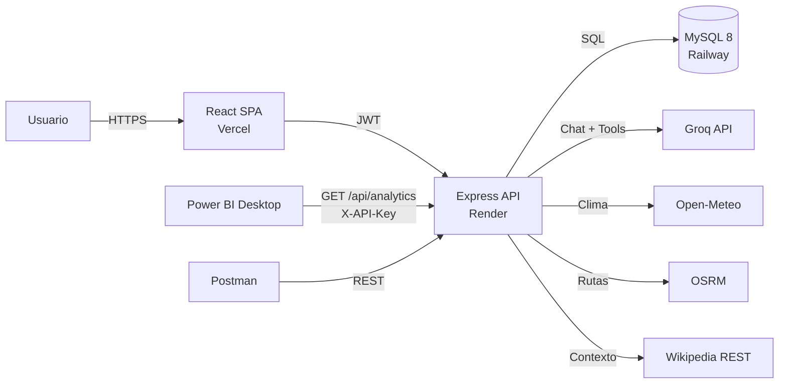

# RutaIA — Proyecto final de Programación Comercial

Aplicación web con servicios de Inteligencia Artificial: chatbot con RAG, dos agentes
multi-paso, autenticación por roles, control de consumo de tokens, API REST documentada,
reporte web y reporte de Power BI.

**Stack:** React + Vite · Express · MySQL 8 · Groq (tool calling) · Docker · GitHub Actions.

---

## Requisitos del proyecto

- Chatbot con **RAG** sobre la base de datos y **memoria conversacional**.
- **Dos servicios adicionales de IA** que resuelvan solicitudes en varios pasos (agentes).
- Login con roles **administrador / usuario** y CRUD administrativo.
- Registro automático de conversaciones, historial y **consumo de tokens** con bloqueo por límite.
- **API REST** con autenticación, permisos, Swagger y demostración en Postman.
- **Power BI** conectado a la API, con filtros por fecha y servicio.
- Pruebas automatizadas, despliegue en la nube y **CI/CD** que despliega solo si las pruebas pasan.

---

## Arquitectura



La página web de reportes y Power BI consumen **el mismo endpoint** de analítica para que
los resultados coincidan.

---

## Estructura del repositorio

```text
PROYECTOFINAL/
├── client/                  # React + Vite (SPA)
├── server/                  # Express API (Node.js)
│   ├── src/
│   │   ├── config/          # Entorno, conexión MySQL, Swagger
│   │   ├── middleware/      # Auth, roles, cuotas, errores
│   │   ├── modules/         # auth, users, catalog, chat, agents, analytics
│   │   ├── ai/              # Cliente Groq, RAG, prompts
│   │   └── tools/           # Herramientas de los agentes
│   ├── scripts/             # seed, ingest
│   └── tests/
├── db/
│   ├── schema.sql           # Creación de tablas
│   └── seed.sql             # Datos de demostración
├── docs/                    # Swagger exportado, Postman, capturas
├── powerbi/                 # Reporte .pbix
├── .github/workflows/       # CI/CD
├── docker-compose.yml       # MySQL 8 local
├── .env.example             # Variables de Docker Compose
└── README.md
```

---

## Modelo de datos

MySQL 8.4 con `utf8mb4_spanish_ci` y almacenamiento en UTC. El detalle está en
[`db/README.md`](db/README.md) y el DDL completo en [`db/schema.sql`](db/schema.sql).

| Tabla | Propósito |
|---|---|
| `users` | Usuarios, roles y cuota mensual de tokens |
| `destinations` / `activities` | Catálogo turístico administrable |
| `documents` | Fragmentos indexados con `FULLTEXT` para el RAG |
| `ai_services` | Configuración de los tres servicios de IA |
| `conversations` / `messages` | Historial del chatbot y de los agentes |
| `usage_logs` | Hechos de consumo para la analítica y Power BI |
| `agent_runs` | Traza de pasos de cada ejecución de agente |
| `api_clients` | API keys con hash para consumidores externos |
| `external_cache` | Caché de Open-Meteo, OSRM y Wikipedia |

Datos iniciales: 3 usuarios, 12 destinos, 48 actividades, 3 servicios de IA,
3 conversaciones, 6 mensajes, 22 registros de consumo y 60 documentos para el RAG.

## Puesta en marcha (local)

### 1. Variables de entorno

```powershell
Copy-Item .env.example .env
Copy-Item server/.env.example server/.env
Copy-Item client/.env.example client/.env
```

Cambia las contraseñas de `.env` si lo deseas.

### 2. Base de datos

```powershell
docker compose up -d
docker compose ps
```

- Host: `127.0.0.1`
- Puerto: `3306`
- Base de datos: `rutaia`
- Usuario: `rutaia`
- Contraseña: `rutaia_local_dev`

Credenciales de demostración:

| Rol | Correo | Contraseña | Cuota mensual |
|---|---|---|---|
| Administrador | `admin@rutaia.local` | `Admin123!` | 500.000 tokens |
| Usuario | `demo@rutaia.local` | `Demo123!` | 50.000 tokens |
| Usuario | `maria@rutaia.local` | `Demo123!` | 30.000 tokens |

Los scripts `db/schema.sql` y `db/seed.sql` se ejecutan automáticamente **solo la primera
vez** que se crea el volumen. Si los modificas:

```powershell
docker compose down -v
docker compose up -d
```

> `down -v` borra todos los datos locales. Úsalo solo en desarrollo.

### 3. Backend

```powershell
cd server
npm install
npm run db:ingest   # genera los 60 documentos del RAG (requiere MySQL arriba)
npm run dev
```

La API queda en `http://localhost:4000` (se implementa en la Fase 2).

### 4. Frontend

```powershell
cd client
npm install
npm run dev
```

La aplicación queda en `http://localhost:5173`.

---

## Variables de entorno

### Raíz (`.env`) — Docker Compose

| Variable | Descripción | Valor por defecto |
|---|---|---|
| `MYSQL_ROOT_PASSWORD` | Contraseña del usuario root | `root_local_dev` |
| `MYSQL_DATABASE` | Nombre de la base | `rutaia` |
| `MYSQL_USER` | Usuario de la aplicación | `rutaia` |
| `MYSQL_PASSWORD` | Contraseña de la aplicación | `rutaia_local_dev` |
| `MYSQL_PORT` | Puerto expuesto | `3306` |
| `TZ` | Zona horaria del contenedor | `America/Bogota` |

### Backend (`server/.env`)

| Variable | Descripción |
|---|---|
| `PORT` | Puerto de la API (4000) |
| `DB_HOST`, `DB_PORT`, `DB_USER`, `DB_PASSWORD`, `DB_NAME` | Conexión MySQL |
| `JWT_SECRET` | Secreto para firmar tokens |
| `JWT_EXPIRES_IN` | Duración del token (1h) |
| `GROQ_API_KEY` | API key de Groq |
| `GROQ_MODEL` | Modelo principal (por defecto `openai/gpt-oss-120b`) |
| `GROQ_MODEL_LITE` | Modelo económico para tareas simples |
| `CORS_ORIGIN` | Origen permitido del frontend |
| `TOKEN_QUOTA_DEFAULT` | Cuota mensual inicial por usuario |

---

## Estado del proyecto

| Fase | Descripción | Estado |
|---|---|---|
| 0 | Preparación: repo, estructura, Docker, entorno, README | ✅ Completada |
| 1 | Base de datos: esquema, datos de prueba, ingesta RAG | ✅ Completada |
| 2 | Esqueleto de la API, Swagger, manejo de errores | ⏳ Pendiente |
| 3 | Autenticación, roles, CRUD y configuración de servicios | ⏳ Pendiente |
| 4 | Chat RAG, memoria, cuotas e historial | ⏳ Pendiente |
| 5 | Agentes multi-paso y fuentes externas | ⏳ Pendiente |
| 6 | Frontend React | ⏳ Pendiente |
| 7 | Analítica web y Power BI | ⏳ Pendiente |
| 8 | Pruebas, Swagger y Postman | ⏳ Pendiente |
| 9 | Despliegue y CI/CD | ⏳ Pendiente |
| 10 | Documentación final y demostración | ⏳ Pendiente |

---

## Seguridad

- **Nunca** subas `.env` ni `server/.env` al repositorio.
- La `GROQ_API_KEY` solo vive en el backend; jamás en el frontend.
- Las contraseñas se almacenan con hash (bcrypt) y las API keys con hash SHA-256.
- Todas las consultas SQL son parametrizadas.

## Nota sobre OneDrive

Este proyecto está dentro de OneDrive. `node_modules` y los archivos de build pueden
provocar bloqueos y lentitud por la sincronización. Si aparecen problemas, mueve el
proyecto a una ruta local como `C:\dev\proyecto-final` y conserva en OneDrive solo el PDF.
